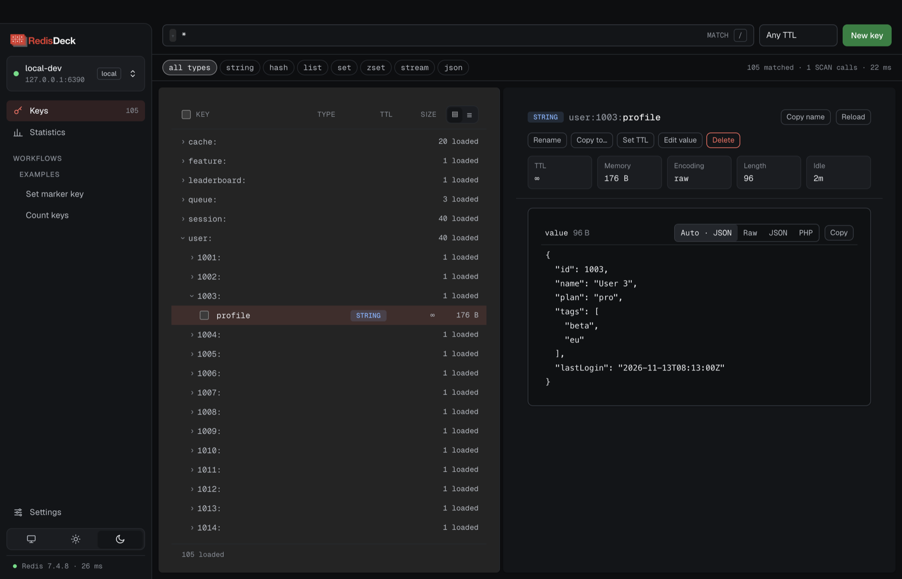
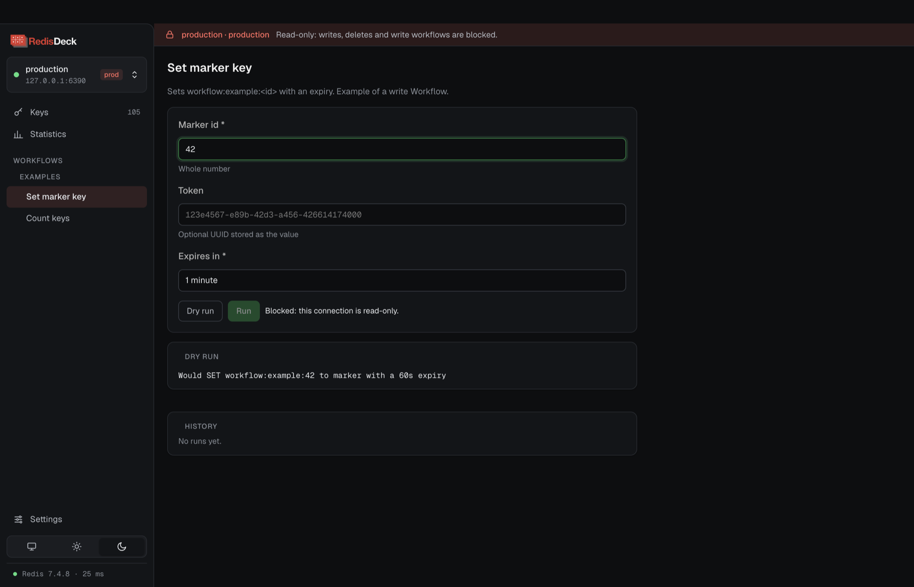
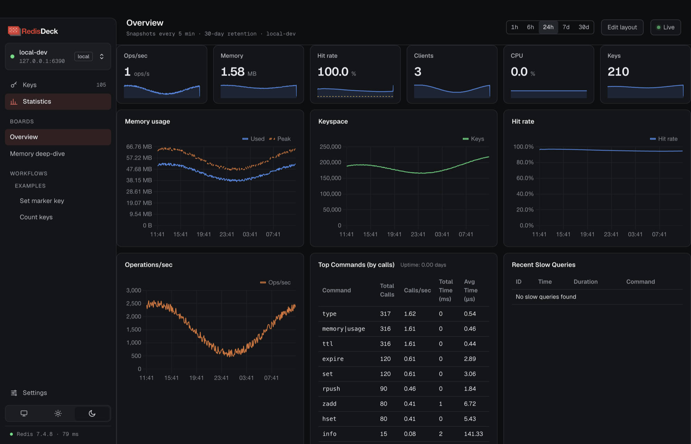

[](https://github.com/DenisYu-1/redis-deck/releases)
[](https://github.com/DenisYu-1/redis-deck/actions/workflows/ci.yml)
[](LICENSE)

**A desktop and web UI for Redis and Redis Cluster. Guarded writes for production, extendable with your own Workflows.**



## Why RedisDeck

- **Your own Workflows.** Turn the commands your team runs by hand into form-driven actions with typed inputs, a dry-run plan and per-Connection run history. One JSON entry and one small JS handler per action.
- **Safe on production.** Tag each Connection `local`, `staging` or `production`. Make it **Read-only**, or require the user to type the Connection name before any write (**Confirm writes**). The server enforces both, not just the UI.
- **Works on clusters other clients choke on.** RedisDeck talks to Redis through `redis-cli`, so cluster Nodes that advertise addresses your machine can't reach (Docker, NAT) and MOVED redirects just work.

## Features

- **Keys**: search by Key pattern across every cluster Node, with paginated results showing type, TTL and size. Saved searches live in the sidebar.
- **Values**: view and edit strings, hashes, lists, sets and sorted sets. Values are decoded as JSON or PHP-serialized, with a raw view as fallback.
- **Bulk actions**: set TTL, export or delete many Keys at once. Rename Keys, or copy them to another Connection.
- **Statistics Boards**: key metrics, memory, keyspace, hit rate and ops/sec trends (1H to 30D), command stats, slow log and memory by Key pattern. Snapshots are kept for 30 days.
- **Connections**: TLS, ACL users and cluster mode. Test a Connection before saving it, reorder Connections by drag and drop, and import or export them as JSON.
- **Light and dark theme.**

| Workflow on a Read-only production Connection                                                              | Statistics Overview Board                                                                                       |
| ---------------------------------------------------------------------------------------------------------- | --------------------------------------------------------------------------------------------------------------- |
|  |  |

## Install

### Desktop app (macOS, Linux)

Download from [Releases](https://github.com/DenisYu-1/redis-deck/releases). On macOS, pick `arm64` for Apple Silicon or `x64` for Intel; on Linux, use the `.AppImage` (x64). `redis-cli` is bundled, so you don't need to install Redis.

<details>
<summary>macOS: "damaged" / "cannot verify" on first launch</summary>

The app is not notarized. Dismiss the dialog, then open **System Settings → Privacy & Security** and click **Open Anyway** next to Redis Deck. Or run:

```bash
xattr -cr "/Applications/Redis Deck.app"
```

</details>

<details>
<summary>Linux notes</summary>

```bash
chmod +x Redis-Deck-*.AppImage
./Redis-Deck-*.AppImage
```

- Requires glibc 2.35+ (built on Ubuntu 22.04).
- Requires FUSE 2 (`sudo apt install libfuse2`). Without it, run with `--appimage-extract-and-run`.
- If startup fails because unprivileged user namespaces are restricted (Ubuntu 24.04+), allow them with `sudo sysctl -w kernel.apparmor_restrict_unprivileged_userns=0`. `--no-sandbox` also works, but it disables Chromium's sandbox, so use it only as a last resort.
- Data lives in `~/.config/`. The Linux build is best effort and has no testing beyond the packaged smoke check.

</details>

Connections, Saved searches and statistics are stored in the per-user app data folder (`~/Library/Application Support/` on macOS).

### Docker

```bash
git clone https://github.com/DenisYu-1/redis-deck.git && cd redis-deck
docker compose up -d
```

Open http://localhost:2222 and add a Connection.

### From source

See [CONTRIBUTING.md](CONTRIBUTING.md).

## Writing a Workflow

Declare the action in `client/plugins/config/config.override.json`:

```json
{
    "plugins": [
        {
            "id": "ops",
            "name": "Ops",
            "actions": [
                {
                    "id": "flush-user-cache",
                    "title": "Flush user cache",
                    "writes": true,
                    "inputs": [
                        {
                            "name": "userId",
                            "label": "User id",
                            "type": "int",
                            "required": true
                        }
                    ]
                }
            ]
        }
    ]
}
```

Then add the handler at `services/workflows/extensions/ops/flush-user-cache.js`:

```js
module.exports = {
    async plan({ userId }) {
        return { text: `Would delete user:${userId}:cache` }; // dry run, must not write
    },
    async run({ userId }, ctx) {
        await ctx.exec(`DEL user:${userId}:cache`);
        return { text: 'Deleted' };
    }
};
```

The action appears in the sidebar. Because it has `"writes": true`, it is refused on Read-only Connections and asks for confirmation on Confirm-writes Connections. Input types, the handler API and the routes are documented in [client/plugins/README.md](client/plugins/README.md).

## How it's built

- **Frontend**: React 18, TypeScript (strict), Vite, Zustand, Chart.js.
- **Backend**: Node.js and Express. Every write route passes through one guard that enforces Read-only and Confirm writes.
- **Transport**: `redis-cli`, by design. Client libraries failed on cluster Node addressing and MOVED redirects, so on clusters every call goes through `redis-cli`. Spawn cost is cut by pipelining many commands through one `redis-cli` stdin session ([ADR 0002](docs/adr/0002-redis-cli-only-transport-on-clusters.md)). Non-clustered Connections use a persistent socket for SCAN. `redis-cli` is spawned with an argv array and no shell, so Key patterns and credentials cannot inject commands.
- **Storage**: SQLite (`better-sqlite3`) with versioned migrations, used for Connections, Saved searches, Workflow history and statistics snapshots.
- **Desktop**: Electron, with a bundled `redis-cli`.
- **Tests**: Jest against a real Redis (no mocks) in CI.

Design decisions are recorded in [docs/adr/](docs/adr/). Domain terms are defined in [GLOSSARY.md](GLOSSARY.md).

## License

[Apache 2.0](LICENSE)
